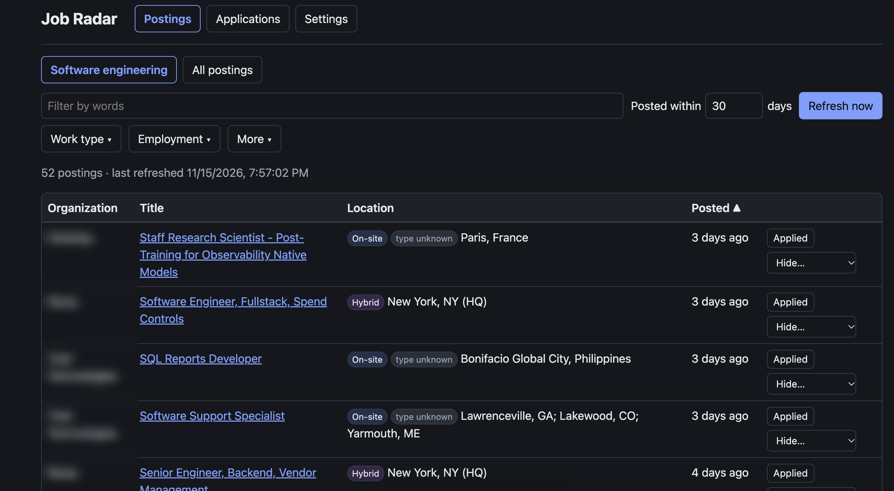
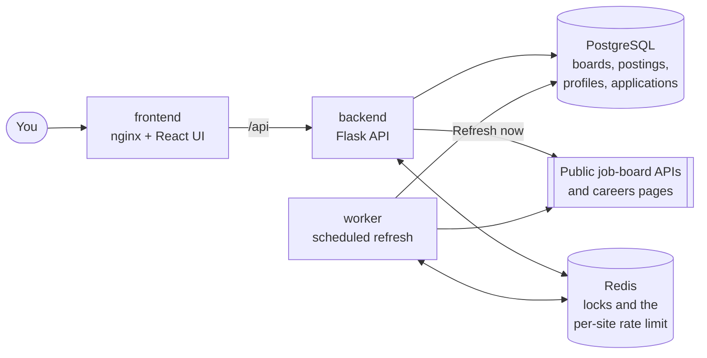

# Job Radar

A self-hosted dashboard for your job search. Follow employers' public job
boards, describe the jobs you want, and see the matching postings in one place:
filtered by title, location, remote policy, posting age and employment type,
with "new since your last visit" badges. Track the jobs you apply to, from
saved to offer.



- **Your preferences, not hardcoded ones.** Job profiles hold the title terms
  you care about. Start from a preset (software engineering, biostatistics,
  HEOR/real-world evidence) or write your own. Each profile is a tab with its
  own posting count.
- **Filters that stay out of the way.** Search by words, set the posting age,
  and narrow by work type, employment type, local only, new only, or hide
  senior roles. Long lists scroll in their own box with the headers in view.
- **Location that understands remote.** List the states and cities you'd work
  in on site. Remote jobs count only when they're open across the US, or
  limited to a state you listed.
- **Applications.** Use a posting's **Actions** menu to mark it applied, or
  add a job you found elsewhere. Then move it through saved, applied,
  screening, interviewing, offer and the rest, with a dated history and notes.
  The same menu hides postings you don't want.
- **Board health.** Settings shows each board's last few refreshes, so a board
  that stopped working is easy to spot.
- **Polite by design.** It reads only public job-board feeds, identifies itself
  honestly, follows robots.txt, makes at most one request per second per site,
  and stores listing metadata only. It never stores job descriptions.

Supported platforms: Greenhouse, Lever, Ashby, Workable, Teamtailor, Breezy,
Recruitee, Jobvite, and any careers page with schema.org `JobPosting` markup.

## Quick start

You need Docker with Compose.

```bash
cp .env.example .env              # set POSTGRES_PASSWORD (and CONTACT_URL, see below)
docker compose up -d --build
docker compose exec backend flask --app job_radar.wsgi boards import config/boards.example.yaml
```

Open http://localhost:8080. Under **Settings**, add a job profile and your
location. Then press **Refresh now**, or wait for the scheduled refresh.

`config/boards.example.yaml` holds demo boards, one or more per platform. Put
your own list in `config/boards.yaml` (git ignores it) and import that, or add
boards one at a time under **Settings > Boards**, where **Test fetch** checks
a board before you add it.

## Configuration

Settings come from `.env` (copied from `.env.example`, never committed).
Everything else (job profiles, location, filters, the refresh interval) is set
in the UI and stored in PostgreSQL.

| Variable | Default | What it does |
|---|---|---|
| `POSTGRES_PASSWORD` | (required) | Password for the bundled PostgreSQL |
| `POSTGRES_USER`, `POSTGRES_DB` | `jobradar` | PostgreSQL user and database |
| `CONTACT_URL` | empty | Added to the scraper's User-Agent so board operators can see who is calling, e.g. the URL of your fork |
| `HTTP_PORT` | `8080` | Port for the UI |
| `SCRAPE_WORKERS` | `8` | Boards fetched in parallel (requests to one site still go one per second) |
| `REDIS_URL` | set by Compose | Only needed when running the backend outside Compose |
| `CORS_ORIGINS` | empty | Only needed when the UI is served from another origin |

## How it works



- The **worker** refreshes every board on a schedule. **Refresh now** in the
  UI starts the same refresh from the backend.
- **Redis** holds a lock so two refreshes never run at once, and the
  one-request-per-second limit for each site, shared by the worker and the
  backend.
- Postings are stored once and filtered when you read them, so changing a
  setting never needs a new refresh.

## Data collection

Job Radar reads only what employers publish for candidates and job sites to
use: documented public job-board APIs and feeds, and schema.org `JobPosting`
markup on public careers pages. On every request it:

- sends an honest User-Agent (`job-radar/<version>`, plus your `CONTACT_URL`),
- checks robots.txt first and respects it,
- waits at least one second between requests to the same site, including
  redirects and robots.txt itself,
- stores only listing metadata (title, organization, location, dates, work and
  employment type, link) and never job descriptions or people's names.

It never works around bot protection, logins or blocks. A board that blocks it
is dropped. The full policy is in [CLAUDE.md](CLAUDE.md#data-collection-policy).

## Development

See [CLAUDE.md](CLAUDE.md) for the architecture, the data model, the full data
collection policy and the contribution workflow: every change starts as a
GitHub issue, lands through a pull request, and is audited before the owner
merges it. The local checks:

```bash
cd backend && ruff check . && ruff format --check . && mypy src
cd backend && TEST_DATABASE_URL=postgresql+psycopg://... TEST_REDIS_URL=redis://... pytest -q -rs
cd frontend && yarn lint && yarn typecheck && yarn test && yarn build
```

The database and Redis tests need a throwaway PostgreSQL and Redis; the
`run-job-radar` skill in `.claude/skills/` shows how to start them.

## License

MIT. See [LICENSE](LICENSE).
